<p align="center">
  
</p>

<p align="center">
  
</p>

<p align="center">
  <a href="https://instagram.com/37omkar"></a>
  <a href="https://lonewolf37.art"></a>
  <a href="mailto:lonewolf370000@gmail.com"></a>
</p>

<p align="center">
  
</p>

<br/>


<table>
<tr>
<td width="58%" valign="top">

**Lonewolf37** — AI artist and creative technologist from India.
I bring Maratha history back to life with AI, build 3D digital heritage, and write the code behind climate-risk and ESG analytics.

- 🎨 &nbsp;AI art & historical restoration — prompt guides at **[lonewolf37.art](https://lonewolf37.art)**
- 🏛️ &nbsp;3D digital heritage & Blender AI tooling
- 🌍 &nbsp;Climate-risk, PCAF & ESG dashboards for banking
- 🛰️ &nbsp;Satellite (Sentinel-2 / Landsat) analytics for agriculture
- ♿ &nbsp;Accessibility AI — sign language & assistive listening

</td>
<td width="42%" valign="top">

```yaml
handle:    Lonewolf37
instagram: "@37omkar  (22.8k)"
craft:     AI Art · 3D Heritage
data:      ESG · Climate Risk · PCAF
stack:     TypeScript · Python
learning:  GARP SCR
open_to:   Collabs & commissions
```

</td>
</tr>
</table>

<br/>


<p align="center"><sub>LANGUAGES & FRAMEWORKS</sub><br/>
  
</p>
<p align="center"><sub>DATA · AI · 3D</sub><br/>
  <br/>
  
  
  
  
</p>
<p align="center"><sub>TOOLS & DEPLOY</sub><br/>
  
</p>

<br/>


<p align="center">
  <a href="https://github.com/37OMKAR/listenwell"></a>
  <a href="https://github.com/37OMKAR/esg-champion1"></a>
  <a href="https://github.com/37OMKAR/signlanguage"></a>
  <a href="https://github.com/37OMKAR/Lonewolf37-awesome-ai-prompts-library"></a>
</p>

<details>
<summary><b>▸ More things I've built</b></summary>
<br/>

| Project | What it does |
|---|---|
| **Climate-Risk Dashboard** | Physical & transition climate risk for a corporate loan book (Python + Plotly) |
| **LongCat Builder** | Blender add-on that builds 3D scenes from AI prompts |
| **Farm NDVI Monitor** | Sentinel-2 vegetation indices → crop predictions for farmers |
| **PCAF Dashboard** | Financed-emissions calculations from Indian corporate data |
| **BOB Earth Challenge** | Carbon-footprint leaderboard web app |
| **Smart Library Kiosk** | Offline AI librarian — face recognition + barcode issue/return |

</details>

<br/>


<p align="center">
  
  
</p>
<p align="center">
  
  
</p>
<p align="center">
  
</p>

<br/>


<p align="center">
  
</p>

<br/>


<p align="center">
  <picture>
    <source media="(prefers-color-scheme: dark)" srcset="https://raw.githubusercontent.com/37OMKAR/37OMKAR/output/pacman-contribution-graph-dark.svg">
    
  </picture>
</p>
<p align="center">
  <picture>
    <source media="(prefers-color-scheme: dark)" srcset="https://raw.githubusercontent.com/37OMKAR/37OMKAR/output/github-contribution-grid-snake-dark.svg">
    
  </picture>
</p>

<br/>


<p align="center">
  <a href="https://instagram.com/37omkar"></a>
  <a href="https://lonewolf37.art"></a>
  <a href="mailto:lonewolf370000@gmail.com"></a>
  <!-- add LinkedIn / YouTube / X here -->
</p>

<br/>
<p align="center">
  
</p>
